  

<table>
<tr>
<td align="center">
 
&nbsp;
&nbsp;
&nbsp;
&nbsp;

  
</td>
</tr>
<tr>
<td>

<h3>&nbsp;Hey there! I'm Lunganlung 👋</h3>

<table>
<tr>
<td width="68%" valign="top">
 

**Ph.D. Research Scholar in Agricultural Statistics** at ICAR–IASRI, New Delhi.

I work where field biology meets statistical computing: building models, ML pipelines and open-source tools that turn messy agricultural data into decisions.

Right now I'm focused on **optimal experimental designs** (Max-Min and definitive screening designs), **time series and nonlinear crop-yield forecasting**, and **machine learning for agro-climatic phenomics**. Most of my work ships as reproducible R and Python packages, like **agribiostat** and **Max-min-Design**.

 
</td>
<td width="32%" align="center" valign="middle">
  
</td>
</tr>
</table>

</td>
</tr>
</table>

### 🚀 &nbsp;Featured work

  
  
  
  

<b>&nbsp;More projects</b>

 

| Project | What it does | Stack |
| :-- | :-- | :-: |
| **[aiml_sp-tm](https://github.com/lunganlungpg/aiml_sp-tm)** | `aimlsptm`: spatio-temporal experimental design, incomplete blocks and field maps | `R` |
| **[stage-aware-dsd-followup](https://github.com/lunganlungpg/stage-aware-dsd-followup)** | Companion code for stage-aware follow-up definitive screening designs | `Python` |
| **[ble-demystified](https://github.com/lunganlungpg/ble-demystified)** | Interactive Bluetooth Low Energy explainer & playground with an ESP32 sketch | `JS` `Node` |

### 📊 &nbsp;GitHub activity

  
  

  

  

  

<b>&nbsp;🛠️ Toolkit</b>

 

  

<b>&nbsp;🎓 Academic journey</b>

 

| Degree | Institution |
| :-- | :-- |
| **Ph.D.**, Agricultural Statistics *(ongoing)* | ICAR – Indian Agricultural Statistics Research Institute, New Delhi |
| **M.Sc.**, Agricultural Statistics | Dr. Rajendra Prasad Central Agricultural University, Pusa, Bihar |
| **B.Sc. (Hons.)**, Agriculture | Central Agricultural University, Imphal |
| **B.Sc.**, Zoology | Manipur University |

